  

  

  
  
  

### 👨‍💻 Sobre mim

- 📍 Curitiba, PR
- 🎓 Cursando **Engenharia de Software** na **PUCPR**
- 💻 Fullstack: APIs em **Java + Spring Boot** e interfaces em **React + TypeScript**
- 🤖 No momento: construindo uma central para orquestrar **agentes de IA** sobre o Claude Code
- 🧱 Arquitetura que gosto de aplicar: **DDD**, **Clean Architecture**, **Vertical Slice**, microsserviços e microfrontends

### 🛠️ Stack

  <picture>
    <source media="(prefers-color-scheme: dark)" srcset="https://skillicons.dev/icons?i=java%2Cspring%2Cts%2Cjs%2Creact%2Cnextjs%2Cnodejs%2Cexpress%2Cvite%2Ctailwind%2Cthreejs%2Cmongodb%2Cmysql%2Cazure%2Caws%2Cdocker%2Cvercel%2Cvitest&perline=9&theme=dark" />
    <source media="(prefers-color-scheme: light)" srcset="https://skillicons.dev/icons?i=java%2Cspring%2Cts%2Cjs%2Creact%2Cnextjs%2Cnodejs%2Cexpress%2Cvite%2Ctailwind%2Cthreejs%2Cmongodb%2Cmysql%2Cazure%2Caws%2Cdocker%2Cvercel%2Cvitest&perline=9&theme=light" />
    
  </picture>

Também: HTML · CSS · Git · Python · PHP

### 🚀 Projetos em destaque

<table>
  <tr>
    <td width="50%" valign="top">
      <b><a href="https://github.com/Le3Dev/orquestrador-app">🤖 orquestrador-app</a></b> 
      Central local para orquestrar agentes de IA sobre o Claude Code: canvas infinito com terminais, subagentes animados, Plan Mode e worktrees git isoladas, com acompanhamento ao vivo. 
      TypeScript · Node 22 · Express 5 · React 19 · React Flow · SSE · vitest
    </td>
    <td width="50%" valign="top">
      <b><a href="https://github.com/Le3Dev/minicrm-arquitetura">🧩 Mini CRM distribuído</a></b> · <a href="https://github.com/Le3Dev/minicrm-ms-clientes">ms-clientes</a> · <a href="https://github.com/Le3Dev/minicrm-function">function</a> 
      Projeto acadêmico (PUCPR): microfrontends com Module Federation, BFF atrás do AWS API Gateway, microsserviços Spring Boot e Azure Function orientada a eventos, documentados em C4 e arc42. 
      Java 21 · Spring Boot · Azure Service Bus · Clean Architecture · Vertical Slice
    </td>
  </tr>
  <tr>
    <td width="50%" valign="top">
      <b><a href="https://github.com/Le3Dev/versiculando">📖 Versiculando</a></b> · <a href="https://versiculando.vercel.app">demo ↗</a> 
      Plano personalizado de leitura da Bíblia com pagamento via Pix: planner em PDF com QR code, calendário .ics com alarmes e papel de parede, sem cadastro. 
      JavaScript · Serverless (Vercel) · pdf-lib · Canvas
    </td>
    <td width="50%" valign="top">
      <b><a href="https://github.com/Le3Dev/SoftLovely">💜 SoftLovely</a></b> 
      Página interativa com cenas 3D, animações de scroll, trilha sonora e pagamento via Stripe, com backend Spring Boot protegido por JWT. 
      Next.js · Three.js / R3F · framer-motion · Tailwind · Stripe · Spring Boot 3
    </td>
  </tr>
  <tr>
    <td width="50%" valign="top">
      <b><a href="https://github.com/Le3Dev/Nova_Linha">🏗️ Nova Linha</a></b> · <a href="https://nova-linha.vercel.app">demo ↗</a> 
      Site de construtora com vitrine de imóveis, galeria de fotos e contato direto pelo WhatsApp. 
      React · TypeScript · Vite · Tailwind · framer-motion
    </td>
    <td width="50%" valign="top">
      <b><a href="https://github.com/Le3Dev/GymTutor">🏋️ GymTutor</a></b> 
      Plataforma que conecta personal trainers e alunos: treinos, sessões, progresso, chat e validação de CREF. 
      Java 21 · Spring Boot · Spring Security · JPA · Thymeleaf · MySQL
    </td>
  </tr>
</table>

### 📊 Estatísticas

  <picture>
    <source media="(prefers-color-scheme: dark)" srcset="https://raw.githubusercontent.com/Le3Dev/Le3Dev/main/profile/stats-dark.svg" />
    <source media="(prefers-color-scheme: light)" srcset="https://raw.githubusercontent.com/Le3Dev/Le3Dev/main/profile/stats-light.svg" />
    
  </picture>
  <picture>
    <source media="(prefers-color-scheme: dark)" srcset="https://raw.githubusercontent.com/Le3Dev/Le3Dev/main/profile/top-langs-dark.svg" />
    <source media="(prefers-color-scheme: light)" srcset="https://raw.githubusercontent.com/Le3Dev/Le3Dev/main/profile/top-langs-light.svg" />
    
  </picture>

  <picture>
    <source media="(prefers-color-scheme: dark)" srcset="https://raw.githubusercontent.com/Le3Dev/Le3Dev/output/github-snake-dark.svg" />
    <source media="(prefers-color-scheme: light)" srcset="https://raw.githubusercontent.com/Le3Dev/Le3Dev/output/github-snake.svg" />
    
  </picture>

